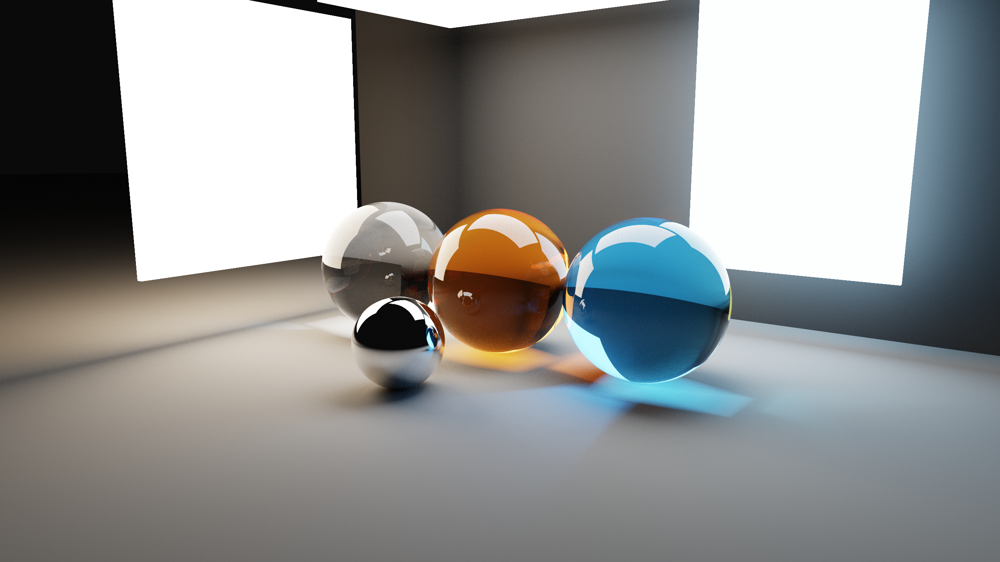
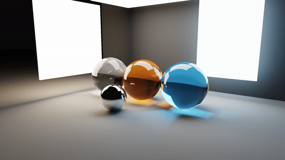
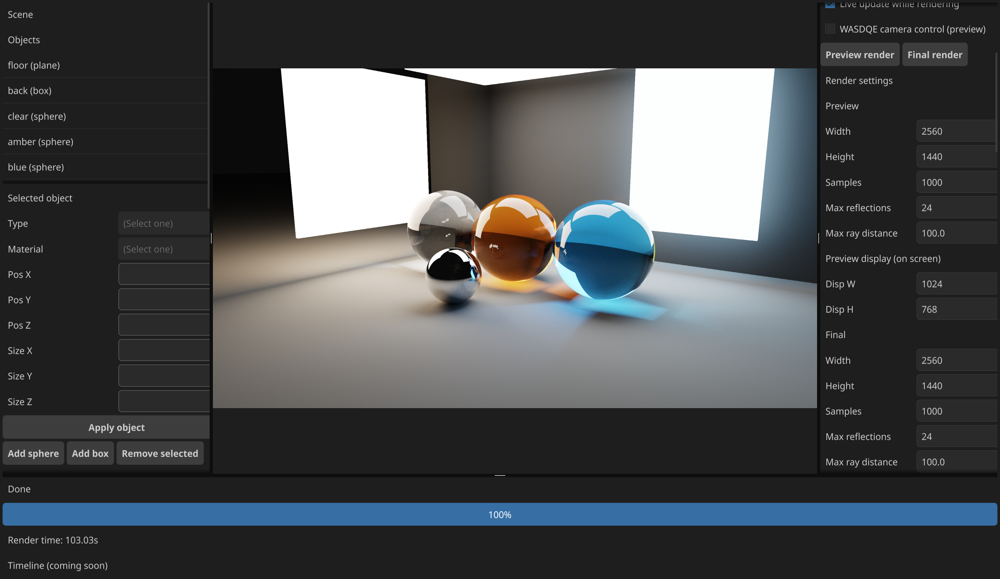
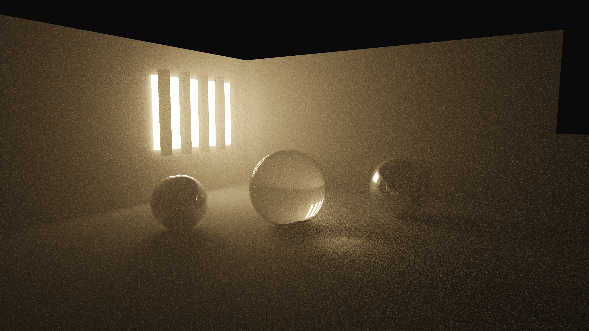
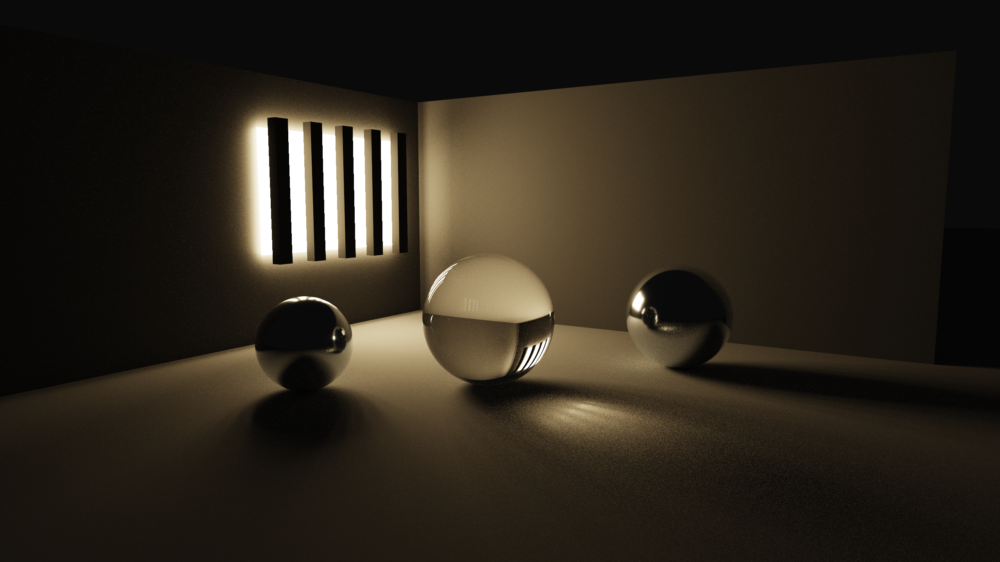
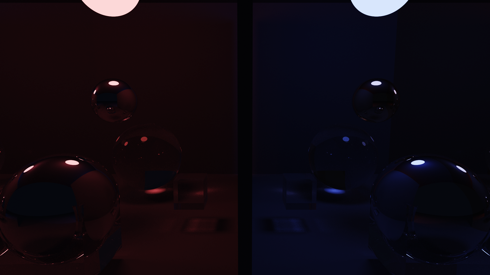
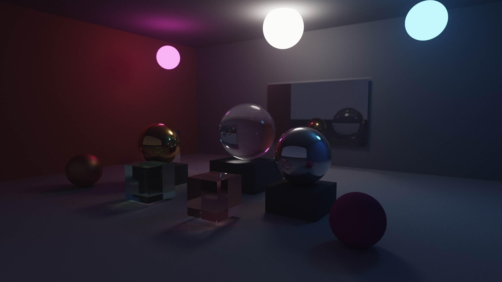
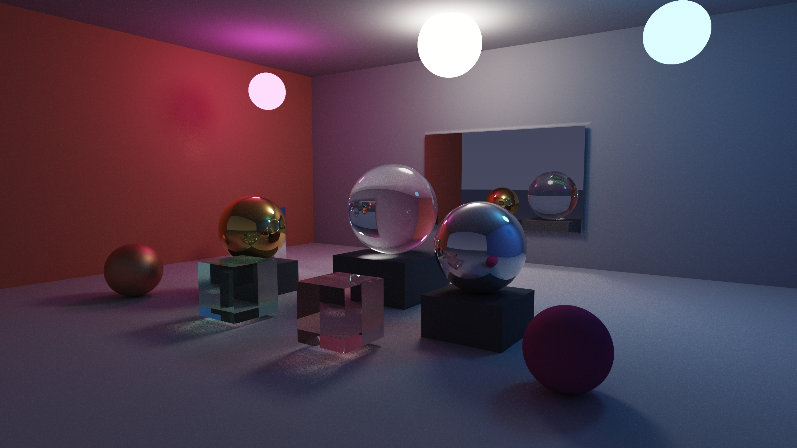
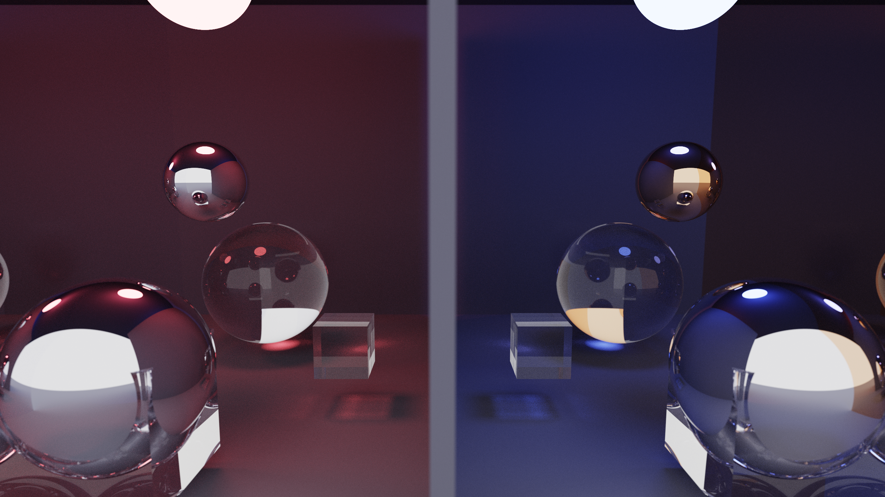
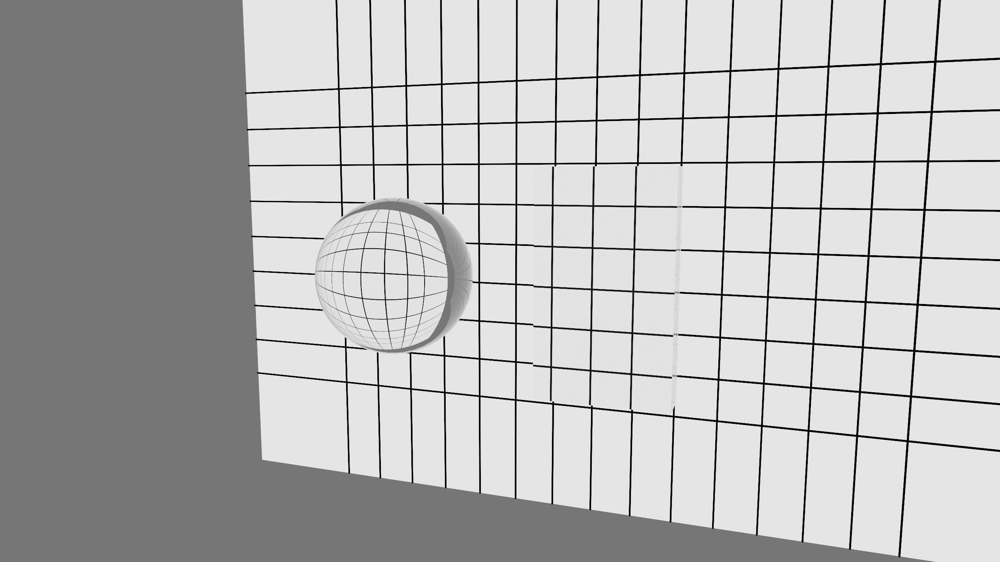

# Go Path Tracer

**An interactive 3D path tracer written in Go, with CPU rendering, an OpenGL compute backend, and a desktop scene editor.**

Explore how light travels through glass, reflects off metal and mirrors, and illuminates a scene through repeated bounces. Edit a scene, move the camera, switch rendering backends, and export the result as an image or a camera animation.

[Русская версия](README.ru.md) · [Quick start](#quick-start) · [Gallery](#gallery) · [Documentation](#documentation)



*Glass studio — rendered on GPU at **2560×1440, 1000 samples per pixel**. [Open full size](docs/images/glass-studio.png) · [Scene](scenes/gallery/glass_studio.json) · [Render settings](docs/images/README.md).*

## Seven-second GPU preview

The MP4 player below works in local Markdown previews that support HTML video. GitHub uses the animated GIF preview beneath it.

<video src="docs/media/studio-preview.mp4" controls loop muted playsinline preload="metadata" width="960" poster="docs/images/glass-studio.png">
  <a href="docs/media/studio-preview.mp4">Watch the seven-second GPU render</a>
</video>

**Animated GIF preview**

[](docs/media/studio-preview.mp4)

[Watch or download the MP4](docs/media/studio-preview.mp4) · [Video settings and source](docs/media/README.md). The animated preview plays directly in this README. The MP4 uses **1920×1080, 24 FPS, 500 SPP, 7 seconds**, rendered on GPU.

## Desktop interface



[Open the interface screenshot at full size](docs/images/interface.png). The editor lets you change objects and materials, move the camera, choose CPU/GPU, and save the finished image.

## What you can do

| Capability | What it provides |
| --- | --- |
| CPU and GPU rendering | A Go worker pool or GLSL compute shaders using OpenGL 4.3+. |
| Geometry | Spheres, axis-aligned boxes, and horizontal planes described in JSON. |
| Materials | Diffuse surfaces, rough metals, ideal mirrors, glass with refraction and absorption, and emissive objects. |
| Lighting | Indirect illumination, sphere and box area lights, multiple importance sampling, and volumetric fog. |
| Scene editor | Object and material controls, camera settings, object picking, and WASDQE camera movement. |
| Interactive preview | Live updates, cancellation, and a colored geometry preview labelled **Wireframe** in the UI. |
| Image output | PNG export, CPU/GPU display denoising, and separate preview/final settings. |
| Camera animation | Interpolated camera movement and MJPEG/AVI export. |
| Repeatable experiments | JSON scenes, fixed seeds, an explicit-resolution CLI, and optical regression scenes. |

This is an experimental renderer for learning, visual experiments, and work on light transport. Small sample counts produce noise; difficult glass caustics can require many samples. The GPU backend uses **OpenGL compute**, rather than a hardware ray-tracing API. Scene names such as `rtx_showcase` do not imply an RTX requirement.

## Gallery

All eight render images use **GPU · 2560×1440 · 1000 SPP · depth 24**. Display denoising is set to **Space 0.05, Color 0**, with extra smoothing disabled. These settings preserve fine detail and visible sampling noise. See [sources, settings and reproduction commands](docs/images/README.md).

### Warm volumetric fog



[Full size](docs/images/fog-shafts.png) · [Scene](scenes/gallery/fog_shafts.json). Warm area lighting and volumetric scattering; the studio scene above and this composition retain the original gallery preview lighting.

### The same room without fog



[Full size](docs/images/fog-clear.png) · [Scene](scenes/gallery/fog_clear.json). Camera, objects and lights match the fog image; only the participating medium is disabled.

### Low light and reflections



[Full size](docs/images/midnight.png) · [Scene](scenes/gallery/midnight.json).

### Prism Atrium with fog



[Full size](docs/images/prism-atrium.png) · [Scene](scenes/engine_showcase.json).

### Prism Atrium without fog



[Full size](docs/images/prism-clear.png) · [Scene](scenes/gallery/prism_clear.json). Fog is disabled and the aperture is zero for a sharp comparison.

### Metals, mirrors, and colored lights



[Full size](docs/images/metal-and-glass.png) · [Scene](scenes/rtx_showcase.json).

### Refraction through glass



[Full size](docs/images/glass-refraction.png) · [Scene](scenes/validation/glass_grid.json). A sphere bends the grid; a parallel slab displaces it. See the [optical validation scenes](scenes/validation/README.md).

## Quick start

### Linux / Ubuntu

Install **Go 1.27.2 or newer**, a C compiler, and the desktop development libraries:

```bash
sudo apt-get install -y gcc pkg-config libgl1-mesa-dev xorg-dev \
  libxcursor-dev libxrandr-dev libxinerama-dev libxi-dev libxxf86vm-dev \
  libwayland-dev libxkbcommon-dev wayland-protocols

git clone https://github.com/MarkJulian19/path_trace_golang.git
cd path_trace_golang
make
make run SCENE=example_simple
```

The first command compiles `bin/pathtracer`; the last opens the editor on CPU. For the scene shown at the top of this page:

```bash
make run SCENE=gallery/glass_studio GPU=1
```

### Windows

With Go and a **MinGW-w64 C compiler** available on `PATH`, build from PowerShell in the repository root:

```powershell
$env:CGO_ENABLED = "1"
$env:CC = "gcc"
go build -o bin/pathtracer.exe ./cmd/render
.\bin\pathtracer.exe -scene scenes/example_simple.json
```

Keep the `scenes/` directory available when running the executable. [Build options and cross-compilation](docs/development.md#building).

### Enable GPU rendering

Choose **GPU** in the editor, or start with:

```bash
./bin/pathtracer -scene scenes/engine_showcase.json -gpu
```

GPU rendering requires a driver with **OpenGL 4.3+**. If initialization fails, the application falls back to CPU and reports it in the status/logs. Under software OpenGL, such as `llvmpipe` in some WSL environments, compute runs on CPU; selecting GPU does not make it hardware accelerated. See [GPU troubleshooting](docs/development.md#gpu-troubleshooting).

### Your first render

1. Start with `example_simple` on CPU and select an object in the scene list.
2. Adjust its material or camera settings and use **Preview render** to inspect the result. Enable **WASDQE camera control** to move through the scene.
3. Set the final resolution and samples, then click **Final render**.
4. After it finishes, choose an output path and click **Save image (PNG)**. Image saving uses the completed final render. **Save scene** writes edits back to the loaded JSON file.

## Render an image without the editor

Use the diagnostic CLI to choose resolution, samples, depth, and seed explicitly:

```bash
go run ./cmd/validate-render \
  -scene scenes/gallery/glass_studio.json -backend gpu \
  -width 2560 -height 1440 -spp 1000 -depth 24 -seed 42 \
  -denoise -denoise-space 0.05 -denoise-color 0 -out output/renders/render.png
```

The example uses the GPU gallery settings. Choose `-backend cpu` to run the Go renderer. This CLI treats GPU fallback as an error, so a GPU comparison cannot silently measure CPU rendering. More samples per pixel (`-spp`) generally reduce noise and take longer.

For a quick render using the application's preset settings:

```bash
make headless SCENE=example_simple OUT=output/renders/example.png
```

[Command-line reference and preset behavior](docs/development.md#command-line-tools).

## Choose a scene

| Scene | Try it for |
| --- | --- |
| [example_simple](scenes/example_simple.json) | A first run with diffuse, metal, mirror, and glass objects. |
| [engine_showcase](scenes/engine_showcase.json) | Prism Atrium: colored lights, materials, and participating fog. |
| [rtx_showcase](scenes/rtx_showcase.json) | Silver and copper surfaces under colored lights. |
| [metal_glass_room](scenes/metal_glass_room.json) | Glass and metal in a simple room. |
| [gpu_showcase](scenes/gpu_showcase.json) | A collection of materials, objects, and light sources. |
| [test_comprehensive](scenes/test_comprehensive.json) | A larger material and geometry test scene. |
| [Validation scenes](scenes/validation/README.md) | Glass interfaces, absorption, noise, gradients, and furnace tests. |

Run `make scenes` to list the top-level scenes. JSON files can be inspected and edited directly; they store the camera, objects, materials, lighting, background, and render settings.

## Documentation

- [Development, CLI reference, and troubleshooting](docs/development.md)
- [Gallery sources and exact render commands](docs/images/README.md)
- [Optical and noise validation scenes](scenes/validation/README.md)
- [Rendering mathematics — PDF](docs/math/gpu_pathtracer_math.pdf) and [LaTeX source](docs/math/gpu_pathtracer_math.tex): background material; the implementation and regression tests determine current behavior.
- [Contributing](CONTRIBUTING.md)

The implementation lives in [`internal/`](internal/): shared scene entities, CPU rendering use cases, an OpenGL GPU adapter, JSON persistence, and the Fyne UI. See the [repository map](docs/development.md#repository-map) for entry points.
